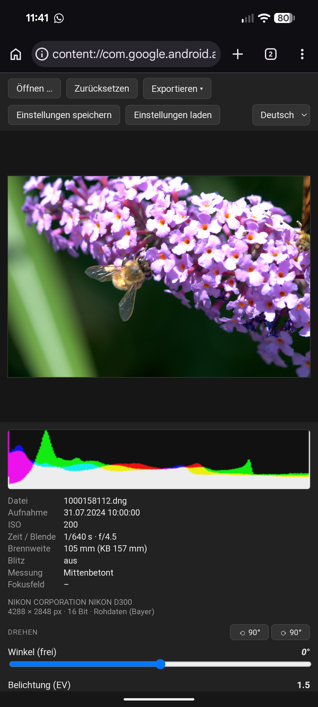
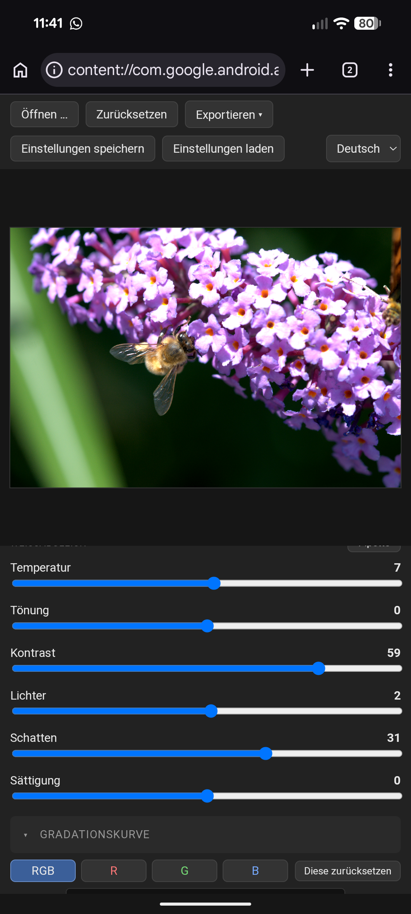
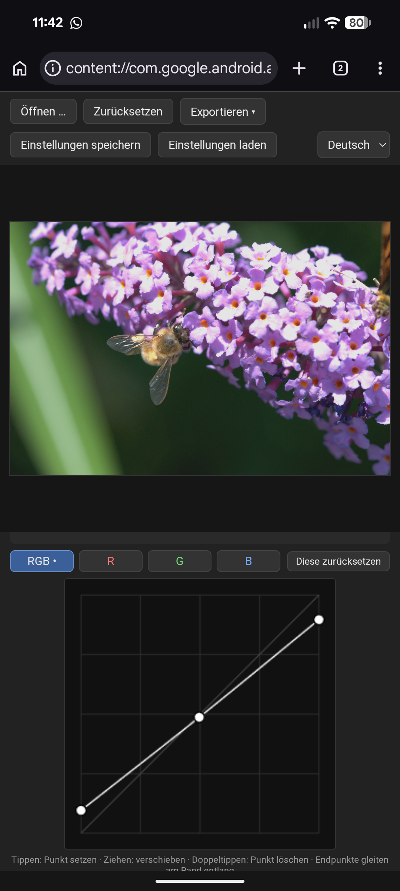

# RAW to DNG Developer 📸 (v0.93 Beta)

Ein zu 100 % installationsfreies Web-Tool zur Archivierung und Entwicklung von RAW-Bilddateien. Die komplette Anwendung besteht aus einer **einzigen, autarken HTML-Datei namens `index.html`**. Sie läuft vollständig lokal in deinem Browser – es werden keinerlei Bilddaten auf einen Server hochgeladen oder im Internet verarbeitet.

Das Tool wurde speziell dafür entwickelt, um proprietäre Kamera-RAWs (wie Nikon .NEF) in das zukunftssichere, offene **DNG-Format zur Archivierung** umzuwandeln. Zudem lassen sich DNG-Dateien direkt im Browser "entwickeln" und als lineares DNG, unkomprimiertes TIFF oder JPEG exportieren, um sie nahtlos in professionellen Bildbearbeitungsprogrammen weiterzuverarbeiten.

## 🚀 Aktueller Status: v0.93 Beta
Das Tool befindet sich im **Beta-Stadium** und wird aktiv weiterentwickelt. Es ist bereits **voll funktionsfähig**, stabil im Kern und bereit für deine Workflows.
- **Neu in v0.93:** Im Exportmenü (sowohl bei 8-Bit als auch bei 16-Bit) gibt es nun die Option, ein DNG zu exportieren, welches das **originale DNG als Backup direkt mit beinhaltet**.

## ⚠️ Wichtiger Kompatibilitätshinweis
Aufgrund der genutzten modernen Browser-Technologien läuft diese Anwendung **ausschließlich unter Google Chrome und Microsoft Edge** (sowie anderen Chromium-basierten Browsern). Firefox und Safari werden aktuell nicht unterstützt.

## ✨ Kern-Features
- **Single-File-App:** Das gesamte Tool steckt in der einzelnen Datei `index.html`. Kein Setup, keine Abhängigkeiten, maximale Portabilität.
- **Urlaubs- & Mobilbereit:** Perfekt für die Reise! Da es plattformunabhängig im Browser läuft, kannst du es im Urlaub auf dem Laptop, an fremden Desktop-Rechnern oder sogar direkt auf dem Smartphone/Tablet (unter Chrome/Edge) nutzen, um unterwegs RAWs zu checken oder umzuwandeln.
- **100 % Local & Private:** Die Bildverarbeitung geschieht ausschließlich im Arbeitsspeicher deines Geräts (Client-Side). Deine Fotos bleiben sicher bei dir und belasten kein Datenvolumen durch Uploads.
- **Nikon NEF-Unterstützung:** Liest nativ die gängigsten und bekanntesten Nikon .NEF-Formate direkt im Browser ein.
- **Neu - Erweitertes DNG-Backup:** Exportiere deine DNGs wahlweise inklusive eingebettetem Original-DNG als sicheres Archivformat.
- **Flexibler Entwicklungs-Export:** Öffne deine DNG-Dateien und exportiere sie mit präziser Kontrolle über die Farbtiefe (8-Bit oder 16-Bit) als JPEG, PNG oder TIFF.
- **Preset-Management:** Sichere deine Entwicklungseinstellungen lokal oder lade Presets für eine schnelle Bearbeitung.
- **Zweisprachig:** Volle Unterstützung für Deutsch und English.

## 💻 Nutzung & Live-Test
Du kannst das Tool auf zwei Arten nutzen und testen:

### Methode 1: Lokal ausführen
1. Lade dir die Datei `index.html` aus diesem Repository herunter.
2. Öffne die Datei mit einem Doppelklick in **Google Chrome** oder **Microsoft Edge**.
3. Ziehe deine NEF- oder DNG-Datei per Drag-and-Drop in das Fenster.

### Methode 2: Direkt im Browser testen (GitHub Pages)
Das Tool ist dank GitHub Pages direkt im Web einsatzbereit, ohne dass du etwas herunterladen musst. Klicke einfach auf den folgenden Link (wichtig: nutze Chrome oder Edge!):

`https://github.io`

*(Ersetze YOUR-GITHUB-USERNAME und YOUR-REPO-NAME mit deinen echten GitHub-Daten, sobald Pages aktiv ist).*

## 🐛 Feedback & Fehler melden (Deine Mithilfe gesucht!)
Da ich dieses Tool als Privatperson in meiner Freizeit pflege, besitze ich natürlich nicht alle Kameramodelle und mir liegen nicht die RAW-Dateien sämtlicher Kameras zum Testen vor. Ich bin hierbei auf die Mithilfe der Community angewiesen!

Falls du das Tool ausprobierst und Fehler bemerkst, freue ich mich über deine Rückmeldung:
- Wird eine deiner Nikon-NEF-Dateien nicht richtig erkannt?
- Sieht ein geöffnetes Bild fehlerhaft aus oder stimmen die Farben nicht?
- Stürzt die Anwendung bei einer bestimmten Datei ab?

**Wichtig für die Zukunft:** Ich werde dieses Tool sehr gerne weiter pflegen und neue Kameramodelle hinzufügen – allerdings nur, wenn das Projekt auch wirklich Anklang findet und aktives Interesse in der Community besteht.

Wenn du einen Fehler findest, erstelle bitte einfach hier auf GitHub ein **Issue**. Nenne darin dein Kameramodell und lade (falls möglich) eine fehlerhafte Beispiel-RAW-Datei hoch, damit ich den Fehler gezielt analysieren und nachbessern kann. Vielen Dank für deine Unterstützung!

## 🛠️ Technische Details & Credits
Dieses Projekt wurde auf Basis meiner funktionalen und visuellen Vorstellungen vollständig von der KI **Claude 3.5 Sonnet** entwickelt. Ziel war es, maximale Funktionalität in einer minimalen, serverlosen Architektur zu bündeln.

## 📄 Lizenz
Dieses Projekt ist unter der **GNU General Public License v3.0 (GPL-3.0)** lizenziert. Details findest du in der mitgelieferten `LICENSE`-Datei.

---

# English Description 🇬🇧

## RAW to DNG Developer 📸 (v0.93 Beta)
A 100% installation-free web tool for archiving and developing RAW image files. The entire application consists of a **single, self-contained HTML file named `index.html`**. It runs completely locally in your browser—no image data is uploaded to a server or processed over the internet.

## 🚀 Current Status: v0.93 Beta
The tool is currently in **Beta** and is actively being developed. It is fully functional, stable at its core, and ready for your workflows.
- **New in v0.93:** Added an export option for DNG files (both 8-bit and 16-bit) that **embeds the original DNG file as a backup** inside the output.

## ⚠️ Important Compatibility Note
Due to the modern browser technologies utilized, this application runs **exclusively on Google Chrome and Microsoft Edge** (and other Chromium-based browsers). Firefox and Safari are currently not supported.

## ✨ Key Features
- **Single-File App:** The entire tool is contained within the single file `index.html`. No setup, no dependencies.
- **Vacation & Mobile Ready:** Perfect for traveling! Since it runs platform-independently in the browser, you can use it on your laptop during vacation, on public desktop computers, or even directly on your smartphone/tablet (using Chrome/Edge) to check or convert RAWs on the go.
- **100% Local & Private:** Image processing happens entirely within your device's local memory (client-side). Your photos stay safe with you, and no mobile data volume is wasted on uploads.
- **Nikon NEF Support:** Natively reads the most common and well-known Nikon .NEF formats.
- **New - Advanced DNG Backup:** Export DNG files with the option to embed the original DNG file as a secure archive.
- **Flexible Development Export:** Open DNG files and export them with precise control over color depth (8-bit or 16-bit) as JPEG, PNG, or TIFF.

## 💻 Usage & Live Test
### Method 1: Run Locally
1. Download the `index.html` file from this repository.
2. Open the file with a double-click in **Google Chrome** or **Microsoft Edge**.
3. Drag and drop your NEF or DNG file into the window.

### Method 2: Test Directly in the Browser (GitHub Pages)
`https://github.io`

*(Replace YOUR-GITHUB-USERNAME and YOUR-REPO-NAME with your actual GitHub data once Pages is activated).*

## 🐛 Feedback & Bug Reports (Your Help Needed!)
Since I am developing this tool as a private individual in my spare time, I obviously do not own every camera model, nor do I have access to sample RAW files from every camera out there to test them. Therefore, I highly rely on the community's help!

If you find a bug, please just open an **Issue** here on GitHub. Mention your camera model and (if possible) provide a sample RAW file that causes the issue so I can analyze and fix it. Thank you so much for your support!
